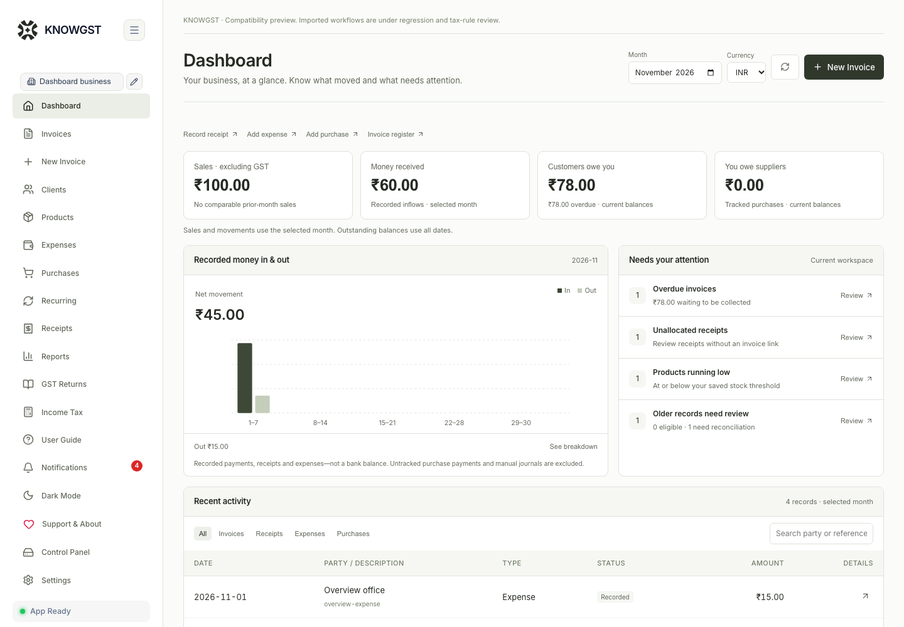

<p align="center"></p>
<h1 align="center">KNOWGST</h1>
<p align="center">Invoicing, bookkeeping and reviewed AI assistance for Indian businesses.</p>
<p align="center">
  <a href="https://github.com/KnowAI-club/KNOWGST/actions/workflows/ci.yml"></a>
  <a href="https://github.com/KnowAI-club/KNOWGST/releases"></a>
  <a href="LICENSE"></a>
</p>

KNOWGST is a single-user desktop application for macOS and Windows. Keep multiple businesses on your own device, create GST documents, track payments and stock, and maintain books with an audit trail. Core bookkeeping works without an internet connection. Optional ChatGPT and email features connect only when you use them.

[**Download desktop app**](https://github.com/KnowAI-club/KNOWGST/releases/latest) · [Installation](docs/DESKTOP-RELEASE.md) · [User guide](docs/USER-GUIDE.md) · [Contributing](CONTRIBUTING.md) · [Release notes](CHANGELOG.md)



## What you can do

| Workspace | Capabilities |
| --- | --- |
| Sales | Tax invoices, quotations, proforma/estimates, bills of supply, composition documents, credit notes and delivery challans; PDF output; recurring invoices; customer receipts and payment history |
| People and stock | Business-scoped clients and products, stock movements, purchases and partial supplier payments |
| Books and reports | Balanced INR journals, automatic supported sales/receipt/expense postings, append-only reversals, account history, source-based reports and historical posting review |
| Tax | GST particulars and deterministic calculations, GST return preparation and income-tax tools with supported-year boundaries |
| AI assistance | Chat with source references; reviewed invoice drafts and image extraction; category suggestions; email drafts; document inbox, matching rules, catalog review, books review and import assistance |
| Your workspace | Neutral light/dark UI, configurable business profiles, local app lock, complete verified backups including PDFs, built-in illustrated guide |

AI suggestions remain proposals. Confirm a draft before applying it; save a financial document or send an email separately. Amounts, tax and stock changes use the application’s transaction logic. See [AI capabilities and boundaries](docs/AI-WORKFLOWS.md).

## Install

Download the installer for your system from [GitHub Releases](https://github.com/KnowAI-club/KNOWGST/releases). macOS packages are provided separately for Apple silicon and Intel; Windows uses a per-user x64 setup. The app bundles its runtime, so users do not need Node.js or a development server.

Release notes identify signing and native test status. These community builds are not publisher-signed or Apple-notarized. Read [installation and verification](docs/DESKTOP-RELEASE.md) before installing, and verify the published SHA-256 checksum. Replacing the app preserves its separate workspace. Use a verified backup when moving between computers or from the developer preview.

## Run from source

Requirements: **Node.js 22.22.3**, **pnpm 9.15.9**, Python 3 and a native C/C++ toolchain. On macOS, install Xcode Command Line Tools; on Windows, use Visual Studio Build Tools with Desktop development with C++.

```sh
git clone https://github.com/KnowAI-club/KNOWGST.git
cd KNOWGST
pnpm install --frozen-lockfile
pnpm dev
```

Open **http://127.0.0.1:4173**. The command starts both the interface and protected local service. SQLite **3.54.1** is compiled from checksum-pinned official source on first startup.

The development workspace is `.local/parity/`; its database is `data/knowgst.sqlite`. `KNOWGST_RUNTIME` selects another workspace and `KNOWGST_WEB_PORT` selects another preview port. Keep the service on loopback. Never point tests at real books.

## Data and integrations

- **Local storage:** SQLite WAL transactions with full synchronous commits. Generated PDFs and integration credentials are stored separately from the database.
- **Backups:** Full verified backups include records, review state, source documents and saved/deleted invoice PDFs. Credentials are excluded. Restore checks file hashes and supports interrupted-restore recovery. [Backup details](docs/BACKUP-RESTORE.md)
- **ChatGPT:** Connect your own eligible account in Settings → Integrations. Available models come from that account. AI requests require an internet connection and use the official OpenAI SDK; no shared developer subscription or hidden API-key fallback. [Integration details](docs/research/AI-GUARDRAILS.md)
- **Email:** Configure your own Resend API key and verified sender to send reviewed invoices and receipts. Drafting does not send anything.
- **Credentials:** Local integration credentials are in an owner-protected file, not an encrypted vault or macOS Keychain. Protect the operating-system account and disk. [Security](SECURITY.md)

## Accounting scope

KNOWGST prepares documents and records bookkeeping activity; it does not submit government returns, obtain an IRN, execute bank transfers or certify tax eligibility. The ledger currently supports INR, while document workflows retain their supported currencies. Purchase/expense input-tax eligibility remains a review task. Source-based reports and ledger-based explanations use distinct, stated accounting bases.

Keep your own verified tax rates and business particulars. Review the [tax-rule coverage](docs/TAX-RULE-REVIEW.md), [accounting boundaries](docs/SQLITE-ACCOUNTING.md) and [feature parity evidence](docs/FEATURE-PARITY.md) for your use case.

## Develop and verify

```sh
pnpm check
pnpm test
pnpm build
pnpm exec playwright install chromium
pnpm test:e2e
```

Browser tests create isolated fictional workspaces. Native installer tests exercise launch, sandboxing, PDF output, backup/restore and restart persistence on each target platform. See [desktop build instructions](docs/DESKTOP-RELEASE.md) and [architecture](docs/ARCHITECTURE.md).

| Path | Purpose |
| --- | --- |
| `apps/parity` | Active React UI, protected Express service, financial workflows and SQLite record storage |
| `apps/desktop` | Electron shell, local gateway and standalone runtime dependency lock |
| `scripts/desktop` | Native packaging, installer smoke tests and checksums |
| `tests/e2e` | Browser workflow, security, accounting, document and layout tests |
| `apps/parity/public/docs` | Bundled user guide and real app screenshots using fictional data |
| `apps/api`, `apps/web`, `packages/domain` | Earlier isolated prototype; not the installed application's active storage |

## Contribute and support

Use [Issues](https://github.com/KnowAI-club/KNOWGST/issues) for reproducible bugs and focused feature requests. Read [CONTRIBUTING.md](CONTRIBUTING.md) before changing financial calculations or migrations. Report vulnerabilities through the process in [SECURITY.md](SECURITY.md); do not attach private books, credentials or OAuth callbacks to public issues.

KNOWGST is published under **GPL-3.0-only**. Existing third-party code retains its original notices. See [LICENSE](LICENSE) and [THIRD-PARTY-NOTICES.md](THIRD-PARTY-NOTICES.md) for provenance and attribution. KnowAI branding is separate from the source-code license.
