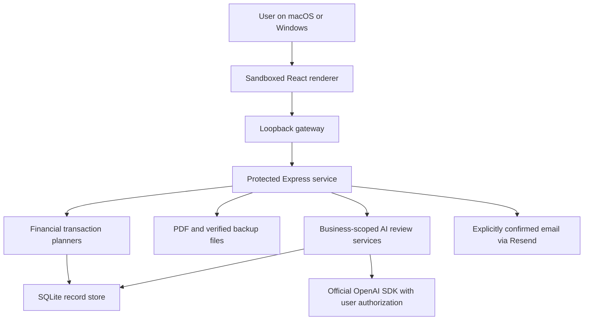

# KNOWGST architecture

This describes the active v1 application. Earlier design proposals and the separate `apps/api` / `apps/web` prototype are historical context, not its runtime architecture.

## Runtime and boundaries

The Electron main process launches a bundled Node service and same-origin loopback gateway. A per-launch random secret protects requests. The renderer has context isolation and sandboxing, without Node integration. Navigation, permissions and WebSocket upgrades are constrained to the application. The service uses a runtime lock so two processes cannot write the same workspace concurrently.

Source development starts the same service with Vite via `scripts/parity-dev.ts`. It binds to loopback and keeps the service secret out of the frontend bundle. This is a single-user local application, not a hosted multi-tenant server.

## Storage and financial writes

`sqlite-storage.mjs` stores versioned JSON-shaped records inside SQLite 3.54.1. The schema uses a strict `records(path, payload, updated_at)` table, a migration table and queued file jobs. The payloads preserve compatibility with the established document structures; this is not a fully normalized relational ledger schema.

Transactions use WAL, full synchronous commits, a busy timeout and immediate write transactions. Invoice and workflow planners stage linked document, payment, inventory and journal updates before commit. Source revisions reject stale edits. Posted accounting entries are append-only; corrections append reversals. Queued file jobs allow PDF mutations to recover after interruption.

Records include businesses/profiles, bills and their snapshots, clients, products, purchases, expenses, receipts, recurring templates, per-business accounting state, metadata and AI review workspaces. Ownership is resolved through the active business. Older ambiguous records require explicit assignment/review.

## AI workflows

The server owns provider credentials and requests. `chatgpt-oauth.mjs` handles PKCE, token refresh, available models and official SDK Responses calls. The WebSocket chat transports status/results; it does not grant the model financial tools.

AI requests use bounded, allowlisted context. Business, account and relevant source fingerprints are checked around asynchronous calls. Reviewed draft resolvers use local records for prices, taxes and identities. Model text is rendered as text, never executable HTML. Financial Save and email Send use separate established routes.

`ai-workflow-store.mjs` persists document queues, explicit matching rules, catalog aliases and review decisions inside a dedicated SQLite collection. Each update is business-scoped and revision checked. Original images and rule state are included in verified backups. Catalog import batches use atomic writes and guarded undo; edits or linked history block unsafe rollback.

See [AI workflows](AI-WORKFLOWS.md) for limits and [AI guardrails](research/AI-GUARDRAILS.md) for defensive controls. Redaction is a supplementary safeguard, not proof that arbitrary text is free of sensitive data.

## Backup and recovery

Full backups materialize SQLite records and include saved/deleted PDFs with SHA-256 manifests. Restore verifies the complete manifest, stages replacement files and journals replacement so interruption can roll back. Local credentials are outside this portable scope. The raw legacy JSON import is not equivalent to a complete verified restore of posted accounting history.

## Verification and packaging

Service tests exercise validation, transactions, accounting reversals, restore failures and AI trust boundaries. Browser tests exercise the real local service with fictional records and simulated provider responses. The desktop matrix builds native bindings and tests installed applications on each target platform. The packaged Node and service dependencies are pinned independently in `apps/desktop/runtime/package-lock.json`.

## Deliberate v1 limits

The ledger currently supports INR and gross expense conventions; multi-currency ledger conversion and automatic input-tax classification are not implemented. There is no bank transfer, government filing, bank-feed sync, automatic reconciliation or unattended collection agent. Credentials have owner-only file permissions but no OS-vault integration. Updates are manual; publisher signing and notarization remain separate follow-up work.
