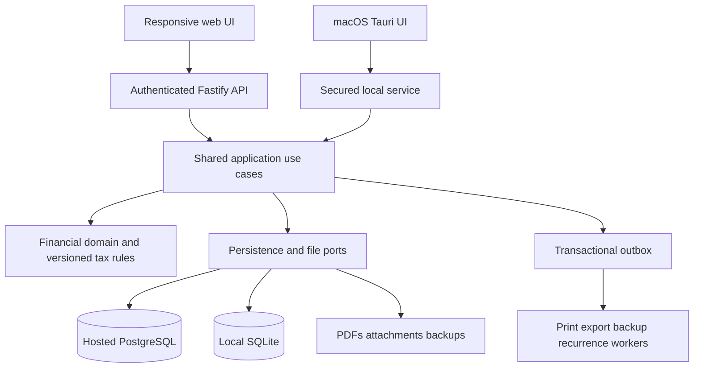

# Know GST — product and technical proposal

Decision baseline: 29 October 2026. Status: proposed implementation specification, not a claim of completed software or statutory certification.

This document supersedes conflicting scope, visual direction, and deployment decisions in FINAL-PROPOSAL.md, ROADMAP.md, LICENSE-DECISION.md, and the earlier architecture ADRs. Release 1 must reproduce the existing product's usable capabilities before adding new product features. The earlier broad accounting/AI roadmap is future scope.

## 1. Product decision

Build Know GST as a separate repository and brand, with newly implemented modules and a shared financial domain engine. Ship a responsive web application and a macOS application. MacBook support is part of macOS support, not another platform. Preserve the original application's local, offline operation as well as offering a self-hosted web edition.

The baseline is [Free-GST-Billing-Software](https://github.com/IamRamgarhia/Free-GST-Billing-Software) at commit `07502f3cad1634a5e7b47a631968152e0bc7e34f`.

Feature parity means equivalent user outcomes, supported data, document outputs, and recovery behavior. It does not mean preserving a security flaw, silently reproducing an incorrect tax rule, or copying the implementation. Each deliberate correction needs a documented old/new example and a regression test.

The source LICENSE inspected is MIT, with a 2026 DiceCodes copyright notice. Propose GPL-3.0-only for new Know GST code, subject to dependency and provenance review before publication. Retain applicable upstream notices for reused material. A new name or rewrite does not itself establish that attribution obligations disappear. Maintain THIRD-PARTY-NOTICES and a dependency license inventory; do not represent the project as having no predecessor.

## 2. Evidence and parity contract

Use these evidence labels in the implementation tracker:

- **Observed:** a source path or executable behavior supports the capability.
- **Claimed:** documentation describes it, but an executable acceptance test is outstanding.
- **Defect:** observed behavior conflicts with an explicit invariant or expected result.
- **Tax review:** legal applicability or effective date requires authoritative verification.
- **Proposed:** new architecture or capability, not legacy functionality.

The following is the source-derived coverage inventory. It is not a statement that every branch has already been exercised. Create a requirement ID, source reference, fixture, target module, and passing acceptance test for each row and each significant subcase before calling parity complete.

| ID | Required release-1 capability | Source areas | Acceptance boundary |
|---|---|---|---|
| P01 | Welcome/setup, business profiles, India/international/both modes, module toggles | SetupWizard, WelcomeGuide, SettingsView | New and migrated businesses can complete setup; hidden modules retain data |
| P02 | Dashboard, outstanding amounts, summaries, notifications, command search, focus mode | Dashboard, notification/search components | Totals reconcile to underlying documents; search opens the correct business record |
| P03 | Tax invoice, proforma/estimate, bill of supply, credit note, delivery challan | InvoiceGenerator, InvoicePreview | All five document types round-trip and print; do not assume debit-note parity |
| P04 | Save, autosave, edit, duplicate, convert estimate, cancellation/uncancellation, trash/restore | InvoiceGenerator, server persistence | Numbering and stock/payment consequences are explicit and transactional |
| P05 | GST components, place of supply override, SEZ, GSTIN checksum/state, HSN/SAC, reverse charge, cess, TDS/TCS | invoice/tax helpers | Versioned golden fixtures; questionable tax rules separated from approved results |
| P06 | Four discount modes, rounding, exchange-rate snapshot, 22 currencies, localized words | invoice helpers and settings | Source currency list/modes copied into parity inventory; exact decimal results |
| P07 | Fiscal-year numbering, prefix/separator/padding, shared or per-business series | InvoiceNumberSettings, series endpoints | Concurrency cannot issue duplicate numbers; cancelled numbers remain reserved |
| P08 | Logo/signature/stamp, terms/notes, internal notes, additional pages | SettingsView, invoice/print components | Private notes never accidentally appear on public documents |
| P09 | Three print layouts, nine presets, A4 and 58/80mm thermal, PDF/direct print | InvoiceGridLayout, PrintSettings, PrintPreviewModal | Multipage rows, margins, 30+ fields, five-language labels/overrides, copies verified |
| P10 | Clients, ledger view, payment history, credit carry-forward/allocation, shared client directory | ClientsView, ClientModal, PartyOutstandingReport | Business books remain separate; legacy unassigned records remain accessible |
| P11 | Products, custom units/UQC, stock, low-stock alerts, bulk edit and CSV import | InventoryView, ProductBulkEdit, BulkCsvImport, StockReport | Stock movement totals match displayed balances; import errors are actionable |
| P12 | Purchases, expenses, categories, GST/ITC, OCR and fuzzy product matching | PurchaseBills, ExpenseTracker, BillOCR | OCR remains a reviewed draft; repeated import cannot duplicate financial effects |
| P13 | Receipts, partial/full payments, allocations, receipt print/reprint, note edits, payment deletion | ReceiptVoucher, receipts handlers | Stable IDs; balances recomputed atomically after edits/deletion |
| P14 | Weekly/monthly/quarterly/yearly recurring invoices | RecurringInvoices, recurring generation endpoint | One occurrence generated once; local schedules catch up after reopening |
| P15 | Revenue/expense P&L, monthly, aging, client/product, stock, tax, TDS/TCS exports | ReportsView, TableExport, report helpers | Reports reconcile to fixtures; do not describe this as a complete general ledger |
| P16 | GSTR-1 sections, HSN, CDNR/CDNUR, document summary, GSTR-3B, GSTN JSON | GSTReturns and helpers | Output schema and reporting-period rules validated before release |
| P17 | GSTR-2B import, supplier-GSTIN/invoice matching, four match classes, CSV | GSTReturns | Original match cases preserved, ambiguous matches remain reviewable |
| P18 | Filing checklist, NIL guidance, e-way JSON/manual portal handoff | GSTReturns and help | Export/handoff is not represented as successful government filing |
| P19 | Income-tax old/new regime, income heads, deductions, senior caps, 234B/C, surcharge, presumptive and ITR-4 mapping | IncomeTax and helpers | Assessment-year-specific rules and boundary fixtures, reviewed separately |
| P20 | WhatsApp handoff, email compose, mobile PDF sharing, Google Drive upload/backup | sharing and Drive helpers | Preserve actual handoff/upload behavior, not invented delivery tracking |
| P21 | Full/selective export/import, daily backup retention, second folder, trash, rollback snapshot | backup/restore/control routes | Complete manifest, integrity verification, and tested restore |
| P22 | Local lock, settings, dark mode, PWA shortcuts, updater, control panel, help/support | AppLock, SettingsView, ControlPanel, SupportView | Local endpoints protected; recoverable updates; help links reviewed |

Observed engineering risks include non-atomic document/payment/stock updates, loosely validated JSON persistence, screen-lock-only security, broad local CORS, incomplete backup success semantics, and unsigned update mechanisms. Prior audit testing is evidence of the old snapshot, not verification of the new system. Full browser coverage and production readiness remain outstanding.

## 3. Architecture and platform choice

Use a modular monolith. Financial operations need one reliable transaction boundary; splitting them into microservices now adds distributed consistency work without improving parity delivery.

| Layer | Proposed choice | Reason |
|---|---|---|
| UI | React, TypeScript, Vite; accessible component primitives | One interface across browser and desktop |
| Styling | CSS variables/design tokens, component variants | Approved Figma system maps directly into code |
| Client state | Query cache for server state; local form state | Avoid duplicate authoritative financial state |
| API | Fastify, Zod boundary schemas, generated OpenAPI | Typed contracts plus runtime validation |
| Domain | Pure TypeScript, arbitrary-precision decimal arithmetic | One financial implementation across editions |
| Hosted database | Self-hosted PostgreSQL | Transactions, constraints, backup ecosystem; no Neon dependency |
| Local database | SQLite with explicit transaction/storage adapter | Full offline operation, low operational cost |
| Desktop | Tauri 2 with packaged local service | Reuse UI/domain; native files, printing, Keychain integration |
| Jobs | Database-backed queue and outbox initially | No mandatory Redis service at first deployment |
| Files | Local filesystem adapter; S3-compatible adapter for hosted | PDFs/backups/attachments are separate from transactional rows |
| Tests | Unit/property tests, real database integration, browser tests | Financial correctness and workflow confidence |
| Delivery | Pinned lockfile, containers for hosted; signed/notarized macOS build | Reproducible releases and controlled updates |

Exact dependency versions must be pinned after compatibility and security checks; these choices do not claim a particular version is the latest. Tauri documents support for bundled external binaries, including the sidecar pattern: https://v2.tauri.app/develop/sidecar/ . Prototype packaging, process lifecycle, and signing before committing the desktop release schedule.



Each workspace has **one authoritative database**. Hosted workspaces use PostgreSQL; local workspaces use SQLite. Local documents can be numbered, saved, paid, and printed without internet. Do not offer conflicting local and hosted writers to the same books. Moving between editions is an explicit validated export/import operation; multi-device offline sync is deferred.

The local browser edition can connect to the packaged loopback service. It is not a promise that a hosted website can issue authoritative offline invoices. Cached hosted screens must clearly distinguish offline drafts from saved records.

## 4. Repository and module boundaries

```text
apps/web                 responsive UI
apps/api                 hosted API composition
apps/desktop             Tauri shell and local service packaging
apps/worker              asynchronous job composition
packages/domain          money, quantities, documents, taxes, allocations
packages/application     commands, queries, transaction orchestration
packages/contracts       runtime schemas and API specification
packages/db-postgres     migrations and PostgreSQL repositories
packages/db-sqlite       migrations and SQLite repositories
packages/ui              tokens and accessible reusable components
packages/printing        document renderer and print fixtures
packages/import-legacy   source readers, mapping, reconciliation
packages/integrations    Drive, share/export adapters
packages/testing         fixtures and cross-adapter contract suite
```

Domain modules: business identity; parties; catalog/stock; sales; purchases/expenses; payments/receipts; recurring; reporting; GST compliance; income tax; document rendering; backup/import; settings/control. Domain code must not import React, HTTP, SQL drivers, provider SDKs, or the filesystem. Application commands own transactions; adapters implement persistence and integrations. Module access goes through explicit interfaces rather than arbitrary cross-module table writes.

## 5. Logical data model

This is the target logical schema. Executable DDL, migration scripts, and generated schema documentation are implementation deliverables; they are not already present.

Conventions: IDs are UUIDs; all owned rows have `workspace_id`; business-specific rows also have `business_id`. Shared parties/catalog are workspace-scoped with business-specific relationships. Foreign keys include tenant scope where needed to prevent cross-workspace references. Mutable roots carry `version`, `created_at`, `updated_at`; timestamps are UTC, legal document dates are explicit date-only values. Business timezone is stored separately.

Money uses signed integer minor units with a currency code and currency exponent. PostgreSQL uses BIGINT where ranges fit; SQLite uses INTEGER; JSON sends money as decimal strings to avoid JavaScript integer limits. Quantities, unit prices before rounding, exchange rates, and percentages use canonical decimal strings in contracts, PostgreSQL NUMERIC in storage, and validated text in SQLite. Arithmetic always uses the shared decimal engine. Never use floating-point or SQLite REAL to calculate financial amounts.

| Entity | Principal fields | Relationships and constraints |
|---|---|---|
| workspaces | id, name, mode(local/hosted), timezone, schema_version | One database authority per workspace |
| business_profiles | id, workspace_id, legal_name, trade_name, country, base_currency, address, contact, logo_asset_id, region_mode | Active business selection does not rewrite existing records |
| business_registrations | id, business_id, registration_type, number, state_code, valid_from, valid_to | GST/PAN and other identifiers; effective-dated |
| fiscal_years | id, business_id, start_date, end_date, label | No overlapping fiscal years for the same policy |
| document_series | id, scope, business_id nullable, document_kind, fiscal_year_id, prefix, separator, padding, next_number | Unique series scope; serialized allocation |
| users | id, identity_subject, email, display_name, status | Hosted identities; local owner need not create an online account |
| memberships | workspace_id, user_id, role | Unique pair; owner is baseline, broader roles staged if not source parity |
| sessions | id, user_id, token_hash, expires_at, revoked_at | Hosted session secrets never stored in plaintext |
| parties | id, workspace_id, name, contact, default_currency, archived_at | Shared client directory |
| party_addresses | id, party_id, type, address, country, state_code, postal_code | Billing/shipping history snapshotted on documents |
| party_registrations | id, party_id, kind, number, state_code | Validated format, business role independent |
| business_parties | business_id, party_id, customer_flag, supplier_flag, payment_terms | Balances are derived from this business's documents/payments |
| units | id, workspace_id, code, label, precision, is_custom | Built-in UQC and custom units |
| products | id, workspace_id, sku, name, description, kind, unit_id, hsn_sac, archived_at | No requirement that every invoice line references a product |
| business_product_defaults | business_id, product_id, price, currency, tax_code, low_stock_threshold, track_stock | Defaults do not mutate historic lines |
| documents | id, business_id, kind, party_id nullable, series_id, number, issue_date, due_date, currency, fx_rate, status, current_revision_id, source_legacy_id | Kinds cover five sales types plus purchase/expense; unique issued number within series |
| document_revisions | id, document_id, revision_no, party_snapshot, business_snapshot, supply_context, rule_version, totals, public_notes, private_notes, terms_snapshot, reason | Immutable revision payload; unique document/revision number |
| document_lines | id, revision_id, position, product_id nullable, description, hsn_sac, unit_snapshot, quantity, unit_price, discount_mode/value, taxable_amount, total | Ordered lines; preserve manual descriptions and historic units |
| document_tax_components | id, revision_id, line_id nullable, component, rate, base_minor, amount_minor, rule_ref | CGST/SGST/UTGST/IGST/cess and reviewed withholding components |
| document_adjustments | id, revision_id, kind, input_value, amount_minor, allocation_method | Document discounts, charges, rounding; deterministic allocation |
| document_links | source_document_id, target_document_id, relation | Estimate conversion, credit reference, supporting document |
| document_events | id, document_id, revision_id, event_type, actor, reason, occurred_at | Issue/edit/cancel/uncancel/trash/restore history |
| expense_categories | id, business_id, name, default_tax_treatment | Preserve source categories and custom values |
| expense_details | document_id, category_id, payment_method, itc_treatment | Expense-specific extension, not a second amount authority |
| purchase_details | document_id, supplier_invoice_number, supplier_invoice_date, itc_treatment | Supplier reference searchable; duplicate warnings reviewed |
| payments | id, business_id, party_id, direction, amount_minor, currency, date, method, reference, note, status | Stable original IDs; reversal/version record for deleted payments |
| payment_allocations | id, payment_id, document_id, amount_minor, created_at, reversed_at | Same business/currency or explicit FX policy; no overallocation |
| credit_adjustments | id, business_id, party_id, amount_minor, currency, reason, source_id | Imported opening credits remain explicit and traceable |
| receipts | id, business_id, payment_id, series_id, number, issued_at, snapshot | Receipt reprint uses issued snapshot |
| stock_movements | id, business_id, product_id, quantity_delta, unit_id, source_document_id, source_revision_id, movement_type, reversal_of | Append-only effects; unique source/effect key |
| stock_balances | business_id, product_id, quantity, projection_version | Rebuildable projection, not independent editable truth |
| recurring_templates | id, business_id, draft_payload, frequency, timezone, next_due_date, end_date, enabled | Snapshot includes template version and numbering policy |
| recurring_runs | id, template_id, scheduled_date, document_id, status, error_code | Unique template/occurrence prevents duplicates |
| print_templates | id, workspace_id, name, layout, preset, version, definition | Three layouts/nine presets represented as versioned definitions |
| print_preferences | business_id, template_id, paper_size, margins, font, scale, colors, fields, labels, copy_policy | Structured schema; whitelist rich-content properties |
| assets | id, workspace_id, object_key, sha256, mime_type, size, purpose | Logos/signatures/stamps and attachments; authorized access |
| document_assets | document_id, asset_id, visibility, position | Public/private visibility explicit |
| rendered_artifacts | id, document_id, revision_id, template_version, locale, object_key, sha256, state | Reproducible PDF input references; artifact failure does not lose invoice |
| tax_rule_sets | id, jurisdiction, tax_type, effective_from, effective_to, version, source_refs, approval_status | Immutable approved version selected by relevant date |
| gst_return_snapshots | id, business_id, registration_id, period, form, revision, rule_version, payload, checksum, status | Prepared/exported/externally-confirmed distinguished |
| gst_return_sources | snapshot_id, document_id, revision_id, section | Trace every amount to a frozen source revision |
| gst_imports | id, business_id, period, format, asset_id, checksum, status | GSTR-2B input provenance and duplicate detection |
| gst_import_entries | id, import_id, supplier_gstin, invoice_number, invoice_date, taxable_minor, tax_components, raw_payload | Preserve input before normalization |
| gst_matches | id, entry_id, purchase_id nullable, match_class, differences, decision, decided_by | Automated suggestion distinct from user resolution |
| income_tax_cases | id, business_id, taxpayer_ref, assessment_year, regime, rule_version, status | Year/regime-specific calculation context |
| income_tax_items | id, case_id, income_head, subtype, amount_minor, source_ref | Typed head/subtype validation |
| income_tax_deductions | id, case_id, section, claimed_minor, allowed_minor, evidence_ref | Allowed amount derived under selected rules |
| income_tax_payments | id, case_id, type, date, amount_minor, reference | Advance/self-assessment/withholding inputs |
| income_tax_results | id, case_id, input_hash, calculation_version, breakdown, export_payload | Reproducible result; no claim of submitted ITR |
| settings | workspace_id, business_id nullable, namespace, schema_version, value | Namespaced validated preferences; no opaque financial truth |
| notification_states | workspace_id, user_id nullable, notification_key, read_at, dismissed_at | Stable keys prevent repeat alerts |
| import_batches | id, workspace_id, source_version, checksum, status, counts, reconciliation | Dry-run and resumable apply states |
| import_mappings | batch_id, source_type, source_id, target_id | Unique source mapping makes re-import safe |
| import_errors | id, batch_id, record_ref, code, field, detail, resolution | Quarantine malformed/unassigned records without losing originals |
| audit_events | id, workspace_id, business_id nullable, actor, action, entity_ref, before_hash, after_hash, request_id, timestamp | Append-only application permissions; redact credentials |
| idempotency_keys | scope, key, request_hash, state, response_ref, expires_at | Reject same key with a different request |
| outbox_events | id, transaction_ref, topic, payload, created_at, delivered_at | Persisted with the business transaction |
| jobs | id, type, payload_ref, state, attempts, lease_until, next_attempt_at, last_error_code | Bounded retries and dead-letter review |
| backup_manifests | id, workspace_id, schema_version, object_refs, hashes, state, created_at, verified_at | Complete only after every required object is verified |
| trash_entries | id, workspace_id, entity_type, entity_id, deleted_at, retention_until, restore_status | Preserve linked restoration semantics |

Required indexes include business/date/status on documents; business/party/date on documents and payments; series/number uniqueness; line revision/position; product/business/time on stock movements; supplier GSTIN/invoice/date for reconciliation; active jobs by next attempt; and import source mapping uniqueness. Search must always include workspace scope. Add indexes based on query plans, not every possible field.

JSON is appropriate for immutable snapshots, provider input, print configuration, and versioned rule outputs. It must not replace typed money, document relationships, allocations, or stock movements. Validate JSON against a versioned schema.

Future-only tables include chart_of_accounts, journals, journal_lines, bank_accounts/feed_entries, reconciliation_rules, approval_workflows, AI_runs, AI_evidence, provider_credentials, and messaging_delivery_events. Do not imply that these exist or are release-1 requirements.

## 6. Financial behavior and transactional rules

The shared calculation function accepts validated document inputs and an explicit rule version; it returns line bases, allocated discounts, tax components, withholding treatment, rounding delta, and payable totals. All output components carry traceable calculation inputs. Currency precision is metadata, not a universal assumption of two decimal places.

Define and test the exact sequence per legacy discount mode: quantity/price extension, tax-inclusive extraction where applicable, discount allocation, taxable bases, taxes/cess, applicable charges/withholding, and document rounding. Do not adopt one generic sequence for every document type or tax case. Freeze working legacy examples first; separately approve defect corrections. Allocate rounding remainders deterministically with a stable line-order rule.

Rules must cover intra/inter-state and applicable UT cases, place of supply override, SEZ, reverse charge, credit notes, tax-inclusive amounts, zero/exempt supplies, negative/zero constraints, and foreign-currency snapshots. Tax applicability must not be inferred from the current GSTIN alone when a historic document stores different facts.

Known review areas include TCS context/thresholds, withholding base, reverse-charge combinations, odd-paisa component splits, invoice-level discounts, and challan/e-way outputs. No live statutory rate/threshold is endorsed by this proposal. Each tax-rule change requires effective dates, authoritative source evidence, and financial review before activation.

**Save/issue:** validate → check version → calculate → reserve number if required → persist revision/lines/taxes → apply stock delta → write audit/outbox → commit. Number allocation and document creation share a transaction. Retry transient conflicts safely; do not recycle a cancelled issued number.

**Edit:** load prior revision and related effects; validate compatibility rules; persist a new revision and effect deltas atomically. Preserve the visible edit capability. Finalized/filed-period corrections require an explicit approved policy rather than silently changing historical reports.

**Payment:** validate business, currency, outstanding amount and allocation policy; insert payment/allocations/receipt and audit together. Excess is a visible unapplied credit. Deletion/reversal recomputes allocations without orphaned receipts or hidden balance changes.

**Cancel/uncancel/trash/restore:** model explicit transitions. Reverse or restore stock effects exactly once. Do not erase a received payment simply because its invoice is cancelled; retain and expose the credit/unallocation policy. Preserve source outcomes where valid and document intentional corrections. Trash restoration must detect number/reference conflicts before commit.

**Recurring generation:** unique occurrence key, deterministic schedule, transactional generation. A closed local app cannot run a background schedule unless a separately installed scheduler exists; catch-up on reopen must be explicit.

## 7. API contracts

Prefix public contracts `/api/v1`. Use cursor pagination, explicit filters and sort allowlists. API dates are ISO dates; timestamps include timezone; decimal and money values are strings. Sensitive responses are not cached by shared proxies.

| Group | Representative operations |
|---|---|
| Workspace/setup | GET/POST businesses, business settings, registrations, series |
| Clients/catalog | CRUD parties, party history, products, units, bulk preview/apply |
| Documents | list/get/create draft, preview calculation, save revision, issue, duplicate, convert, cancel, uncancel, trash, restore |
| Payments | create/allocate/reverse payment, edit note, receipt get/render |
| Purchases/expenses | validated document commands plus type-specific queries |
| Stock | movements, balances, stock report; adjustments only through an audited command |
| Recurring | templates, occurrence preview, generate due, pause/resume |
| Reporting | named reports, CSV export, filters and as-of date |
| Compliance | return preview/snapshot/export, 2B import/match/review, ITR calculate/export |
| Printing | template preview, render job, authorized artifact download |
| Recovery | backup create/status/list/verify/restore, legacy dry-run/apply, trash |
| Operations | health/readiness, version/update status, authorized control actions |

Writes that can be retried require `Idempotency-Key`; updates require an expected `version` or If-Match. A successful issue response includes document ID, number, revision, version, calculated totals, and any pending render job. Calculation preview never reserves a number or changes stock.

Errors have `code`, safe `message`, optional field errors, and `request_id`. Use 400/422 for invalid inputs, 401/403 for authentication/authorization, 404 without cross-tenant disclosure, 409 for version/number/transition conflicts, and 429 for limits. Never return stack traces, filesystem paths, or provider secrets to users.

## 8. Security and local behavior

Hosted authentication uses a maintained authentication implementation with secure HttpOnly cookies, session expiry/revocation, CSRF protection where applicable, rate limits, and explicit workspace authorization. Enforce ownership on every query, mutation, export, and artifact download. Test tenant isolation independently from normal workflow tests.

PostgreSQL row-level security is defense in depth, not a replacement for application checks. Use a non-owner runtime role and correctly scoped transaction context; owner/superuser bypass behavior must be accounted for. Reference: https://www.postgresql.org/docs/current/ddl-rowsecurity.html .

Local service binds loopback only, validates origin/host, and requires a per-launch secret or equivalent authenticated IPC boundary. The PIN is a user-facing lock, not sufficient API authorization. Native filesystem operations use allowlisted capabilities. No arbitrary shell execution from request parameters.

Use macOS Keychain for desktop secrets; hosted secrets come from an encrypted secret store or tightly controlled deployment secrets. Do not persist API keys in settings JSON, browser storage, backups, logs, or Git. SQLite database encryption is a packaging decision requiring a tested SQLCipher/native spike; do not promise it is already available. Protect files with OS permissions, and define encrypted backup recovery independently.

Sanitize rich terms/notes; validate file type/size; prevent path traversal and unsafe archive extraction; restrict outbound URL fetching against SSRF. Signed updates require verified manifests, package checksums, and rollback. Dependency scanning, secret scanning, and a security reporting policy are release requirements.

## 9. Files, backup, migration, and recovery

Use content-hashed assets with scoped metadata. Database transactions cannot atomically commit an external PDF, so create a pending artifact record/outbox job, write a temporary object, verify checksum, then publish the artifact reference. Retry without issuing another invoice. Clean orphaned temporary files by age and reference checks.

Backups include database snapshot, referenced assets, settings, format version, manifest and hashes. A second-folder failure must be reported as partial failure; today's existing scheduled backup must not make a newly requested manual backup appear successful. Verify integrity before marking success. Retention runs only after a verified replacement exists.

Restore to a staging database/folder, validate schema and checksums, reconcile references and balances, take a pre-restore snapshot, then switch authority during maintenance. Retain rollback until verification passes. Test encrypted backup recovery without the original machine. Hosted PostgreSQL recovery needs base backups and WAL/PITR design; local mode needs consistent SQLite snapshots. Recovery objectives must be agreed against actual hosting and tested, not assumed.

Legacy migration reads source JSON/PDF/backup data without mutating it. Record source hashes and version; map stable IDs; normalize dates/decimal values; preserve document snapshots and unsupported original fields in provenance records. Import profiles, shared clients, products, invoices, purchases, expenses, receipts/payments, recurring templates, settings, templates, PDFs and trash. Keep unassigned records visible in a review queue; never attach them to an arbitrary business.

Dry-run produces counts and warnings by entity/business/currency, document totals, outstanding balances, credits and stock comparisons. Apply in transactions with source-ID mappings. Re-run is idempotent. Resolve malformed records in quarantine with the original input retained. Final migration gate requires exact explained reconciliation and readable sample PDFs, not only matching row counts.

Schema migrations are numbered, tracked, reviewed and tested on both engines. Prefer additive expand/migrate/contract changes. Test upgrades from every supported release and failure recovery. Financial migrations need before/after reconciliations. Rollback may mean restoring a verified snapshot rather than an unsafe down-migration.

## 10. Design and screen specifications

Use the approved Figma foundation: Inter/sans-serif, white and neutral surfaces, ink `#070D15`, paper `#FCFCFD`, accent `#3158E8`, border `#E3E7ED`. Minimal working software, not editorial typography. The earlier lime/editorial direction is superseded. Token names must be semantic and have tested light/dark equivalents; these hex values are starting foundations, not a completed contrast audit.

Shell: stable business switcher, concise module navigation, command search, page title, primary action, useful filters. Desktop lists use a contextual detail panel where appropriate. Mobile replaces that panel with a full-screen detail view and uses task-focused navigation. Tables support meaningful column priorities, keyboard navigation, sorting/filtering, and export; do not squeeze desktop tables into unreadable mobile layouts.

Core reusable components: buttons, fields, decimal/currency inputs, date controls, comboboxes, tax selectors, party/product pickers, line-item editor, status badges, tables, side panels, confirmation dialogs, file dropzones, alerts, toasts, skeletons, empty/error states, pagination and print preview controls. Every interactive component requires keyboard, focus, disabled, loading, validation and read-only states.

Screen coverage must follow P01–P22, including hidden workflows: unassigned-record resolution, failed import rows, payment reversal, recurring failure, backup partial failure, restore conflict, expired Drive authorization, empty reports, filing validation, lock recovery and unavailable offline actions. Avoid presenting an AI assistant or bank-feed screen as release-1 parity.

Accessibility target: WCAG 2.2 AA, visible focus, semantic structure, adequate contrast, non-color status labels, reduced motion, screen-reader form errors and practical touch targets. Test actual keyboard and screen-reader workflows, not just automated scores.

Generated visual references are concepts, not financial fixtures or proof of implementation:

- `design/concepts/figma-overview-v2.png`
- `design/concepts/figma-invoice-workspace-v2.png`
- `design/concepts/figma-transaction-review-future-v2.png` is future-only.

## 11. Integrations and AI boundary

Release 1 preserves share links/OS sharing, email compose, OCR assistance and Google Drive behavior at observed scope. Share initiation is not proof of delivery. Google OAuth credentials and tokens need encrypted storage, revocation handling and recoverable upload retries.

After parity: Resend transactional email, official WhatsApp APIs, bank feeds and AI can be evaluated through adapters. Neonize/unofficial WhatsApp automation requires a separate reliability, account-policy and security decision; it is not a baseline dependency. Do not confuse Neonize with Neon PostgreSQL.

AI can later extract draft bill data, suggest classifications, explain reports with cited rows, and flag anomalies. Deterministic code remains responsible for tax amounts, allocations and final reports. AI cannot silently issue documents, edit books, file returns, or send external messages. Require preview/approval, scoped tools, tenant isolation, redacted telemetry, prompt-injection defenses and an audit trail.

Hosted API usage, bring-your-own-provider keys, and local models are separate future options. Do not promise that a normal ChatGPT subscription supplies a general third-party API entitlement or that “Sign in with ChatGPT” is available for this product until current official eligibility and integration terms are verified. Never reuse this assistant's credentials or subscription tokens.

## 12. Verification, operations and release gates

Financial tests: golden legacy fixtures plus independently checked expected values; property tests for sum/rounding/allocation invariants; boundary cases by rule version; cross-engine equality; concurrency for numbering and payments; cancel/restore idempotency; cross-business isolation.

Workflow tests: onboarding through invoice/payment/reprint, purchase-to-stock, expenses/reports, recurrence catch-up, GSTR exports/2B matching, income-tax cases, import and backup restore. Exercise macOS packaged binaries, not only a browser development server. PDF visual regression needs long descriptions, page breaks, language labels, thermal sizes and private-field exclusion.

CI gates: lint/type checks, domain tests, both database adapter suites, migrations, API contract drift, browser smoke suite, production build, dependency/license/secret checks. A release also requires packaged desktop installation/update/rollback and a restore drill. Manual visual review remains necessary for critical screens and PDFs.

Observability: structured redacted logs with request/job IDs, error rates, queue depth, generation/backup failures, migration status and database health. Health endpoints distinguish process liveness from readiness. Do not log financial documents or personal details by default. Fatal state should fail safely rather than continuing after an unrecoverable exception.

Performance proposals to benchmark: paginated lists with realistic large datasets, indexed report queries, bounded memory exports, and background PDF/backup jobs. Establish p95 budgets on named hardware and dataset sizes before using numerical performance claims in marketing. Cache only rebuildable projections and invalidate them through committed events.

Hosted initial deployment: reverse proxy/TLS, web assets, API, worker, PostgreSQL and file storage on owned infrastructure, with off-host backups. Keep the database off the public internet. Document hardware costs separately from operational labor; self-hosting does not mean zero cost. Container health alone is not production acceptance.

## 13. Delivery phases and acceptance

| Phase | Deliverable | Exit gate |
|---|---|---|
| 0 — parity freeze | Source inventory, behavior recordings, sample data, tax issue register, license inventory | Every P01–P22 requirement mapped; claims/defects distinguished |
| 1 — foundations | Monorepo boundaries, domain money primitives, DB adapters, migrations, authenticated local/hosted shell, tokens | Cross-adapter contracts and packaged desktop feasibility pass |
| 2 — first vertical slice | Business setup → client → product → invoice draft/issue → preview/PDF → receipt/payment → reopen | Same validated results in local SQLite and hosted PostgreSQL; visual and regression checks pass |
| 3 — core parity | Remaining document types/discounts/numbering/print options, clients, inventory, purchases, expenses, recurring | Financial and stock parity suite passes |
| 4 — compliance/recovery parity | Reports, GST/2B/ITR, imports, backup/restore, Drive/sharing, settings/control/help | Reviewed tax fixtures, exports and recovery drill pass |
| 5 — release hardening | Full migration, accessibility, performance, security, signed releases, documentation | Complete parity traceability and operational acceptance |
| 6 — expansion | AI, provider delivery, bank reconciliation, richer accounting | Separate product proposal and acceptance criteria |

Do not estimate a fixed completion date until phase 0 fixtures and the desktop/storage spike expose the real scope. Each module is independently reviewable, but the product is not declared a parity replacement until all required outcomes pass. Development can happen in the new repository while the original continues serving users; migration is a reversible, deliberate cutover.

## 14. First-slice definition and current truth

The first slice must persist a business, client and product; calculate and save an invoice; issue a unique number; produce a preview/PDF; record a partial/full payment and receipt; survive restart; and export/restore a tested backup. Include validation, audit events and error recovery from its first implementation. Add a fixture for every supported tax case in that slice before replacing legacy calculations.

Implementation has begun with a local invoice development increment. See [implementation status](IMPLEMENTATION-STATUS.md) for completed behavior and remaining boundaries. It is not the complete backend, full proposed schema, statutory tax engine, or production-ready parity build. This proposal defines what must be built and verified, and supersedes suggestions that the broader AI/accounting vision belongs in release 1.
